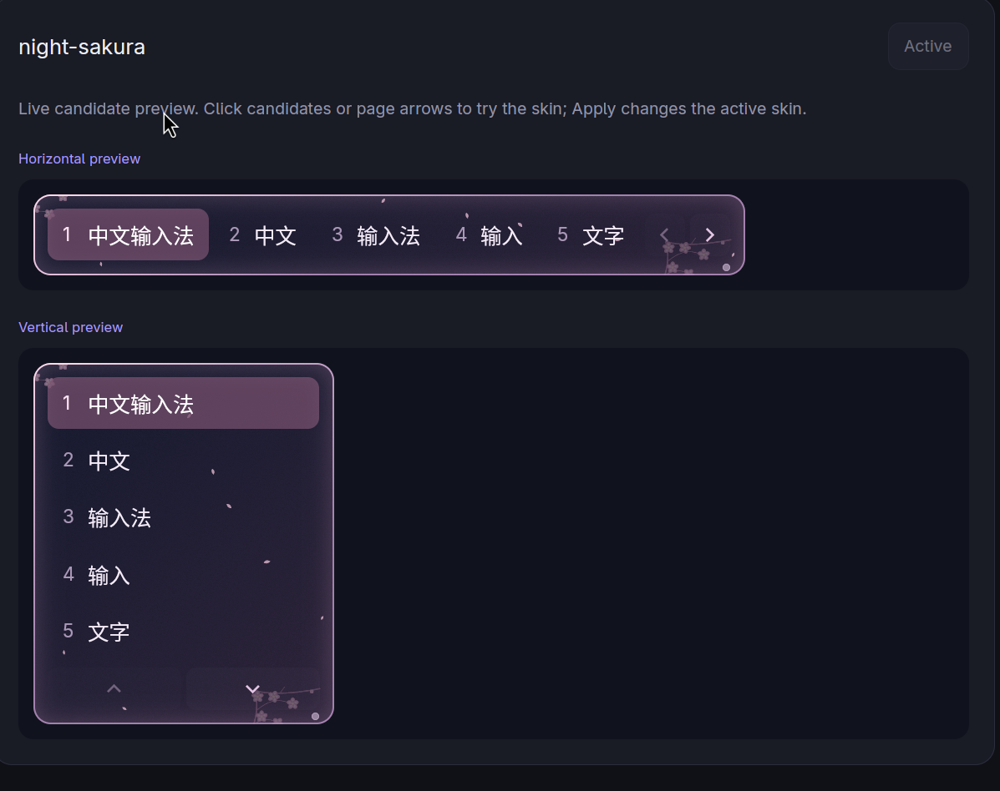

# Mirix

English | [简体中文](README.zh-CN.md)

A Linux input method framework built with Rust and [GPUI](https://github.com/cradiy/gpui).
Mirix supports Wayland input, XWayland/XIM, out-of-process engines, candidate-panel skins,
and engine-defined settings. English keyboard and Pinyin engines are included.

Mirix is licensed under [MIT](LICENSE-MIT) OR [Apache-2.0](LICENSE-APACHE).

[Protocol v1](docs/protocol-v1.md) · [Pinyin guide](docs/pinyin.md)

## Why Mirix

I wanted a Linux input method framework with a modern interface, customizable skins,
and engines independent of the UI—so I could shape my own typing experience.

## Features

- Modern candidate-panel skins: rounded surfaces, gradients, image layers, and optional animations.
- Horizontal and vertical candidates, preedit display, and pronunciation labels.
- Independent engine processes with a shared protocol for candidates, settings, shortcuts, and tray menus.
- Input methods and skins installed as directories; enable and select them in Settings.

## Candidate preview

Night


Midnight


Night Sakura



## Pinyin setup

The included Pinyin engine is not a ready-to-use input method out of the box.
Only a character dictionary is bundled; you need to import your own phrase dictionaries.
Place UTF-8 TSV files in `~/.config/mirix/input-methods/pinyin/dictionaries/`,
then select **Reload dictionaries** in Pinyin settings.
See the [Pinyin guide](docs/pinyin.md#add-pinyin-dictionaries) for the file format.

## Install

With Rust, Nushell, and GPUI's system dependencies installed, run:

```sh
nu scripts/deploy.nu
```

This builds release binaries and installs the daemon, panel, engines, bundled skins,
and application launcher. Existing configuration and dictionaries are preserved.
Run as your desktop user, not with `sudo nu`; protected installation paths request sudo separately.

- `--dry-run`: inspect installation paths without making changes.
- `--no-restart`: install without accessing systemd or restarting the service.
- `--update-skins`: back up and replace bundled skins already installed.

The default binary directory is `/usr/local/bin`. An existing user service is restarted.
For the first installation, exit other input methods, then set up the service from your Wayland session:

```sh
install -Dm644 deploy/mirix.service "$HOME/.config/systemd/user/mirix.service"
systemctl --user daemon-reload
systemctl --user enable --now mirix.service
```

Alternatively, run `mirixd --no-xim` directly; do not run it alongside the service.
The compositor must support input-method, virtual-keyboard, and input-popup protocols.
Applications must support Wayland text input and must not be forced to use another input
module through `GTK_IM_MODULE` or `QT_IM_MODULE`.

```sh
systemctl --user restart mirix.service     # Restart
systemctl --user stop mirix.service        # Stop
journalctl --user -u mirix.service -f       # Follow logs
```

If the service lacks the Wayland environment, run
`systemctl --user import-environment WAYLAND_DISPLAY XDG_CURRENT_DESKTOP` from the desktop session, then restart it.

## Use

- Launch Mirix from the application menu; its context menu opens Settings.
- `mirix-panel --settings` manages input methods, switching order, shortcuts, language, and skins.
- `Ctrl+Space` cycles through enabled input methods in order.
- The English keyboard supports Compose, dead keys, and `Ctrl+Shift+U` Unicode input.
- The tray selects input methods, skins, and engine-provided menu entries.
- See the [Pinyin guide](docs/pinyin.md) for typing, dictionaries, profiles, and personal words.

## Configuration and extensions

Default paths follow XDG_CONFIG_HOME and XDG_DATA_HOME:

| Path | Purpose |
| --- | --- |
| `~/.config/mirix/config.toml` | Enabled methods, shortcuts, language, and skin selection |
| `~/.local/share/mirix/input-methods/<ID>/engine` | Input method executable |
| `~/.local/share/mirix/skins/<ID>/skin.toml` | Skin package entry point |

To install an input method, add its directory, refresh Settings, and enable it.
`input_methods.enabled` records user choices, not an installation registry.
Skins accept installed IDs or explicit paths; discovery does not scan project directories.
Refresh the skin list after installation. Settings save changes automatically;
restart after manually editing the main configuration. Explicit CLI arguments take precedence.

[mirix-engine-japanese](https://github.com/cradiy/mirix-engine-japanese.git) is an example
Japanese engine demonstrating integration with Mirix, not a full-featured input method.

## Preview and development

```sh
# Offline settings: no daemon connection or personal configuration access
cargo run -p mirix-panel -- --settings-demo examples/settings/workspace
cargo run -p mirix-panel -- --settings-demo examples/settings/controls.json

# Candidate-panel preview
cargo run -p mirix-panel -- --demo --skin skins/midnight

# Build engine executables before running integration tests
cargo build --workspace --bins
cargo fmt --all -- --check
cargo test --workspace --all-targets
cargo clippy --workspace --all-targets -- -D warnings
```
